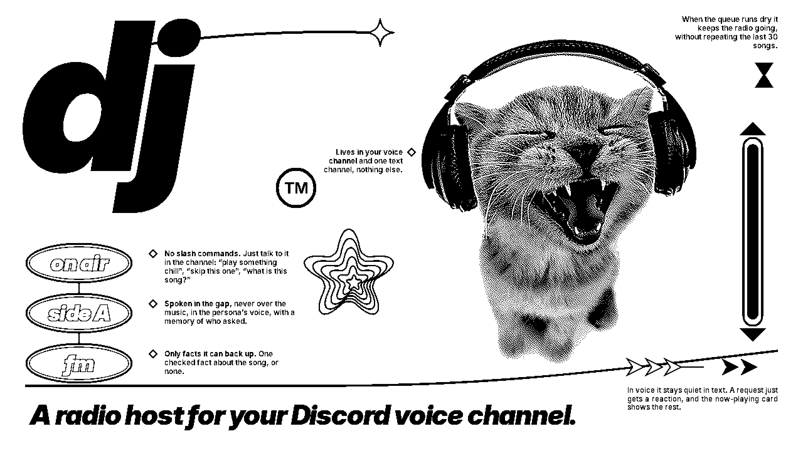
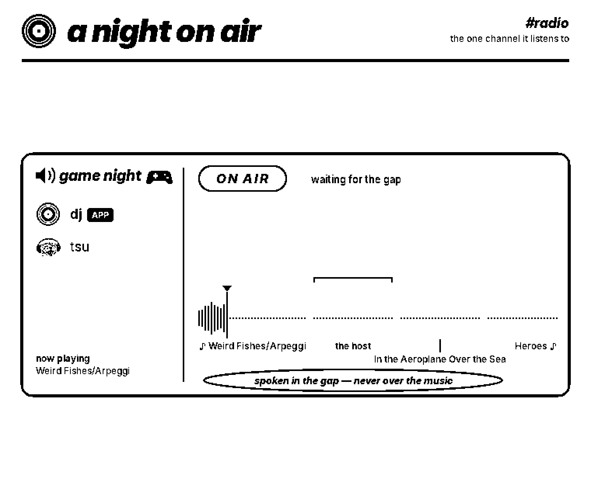
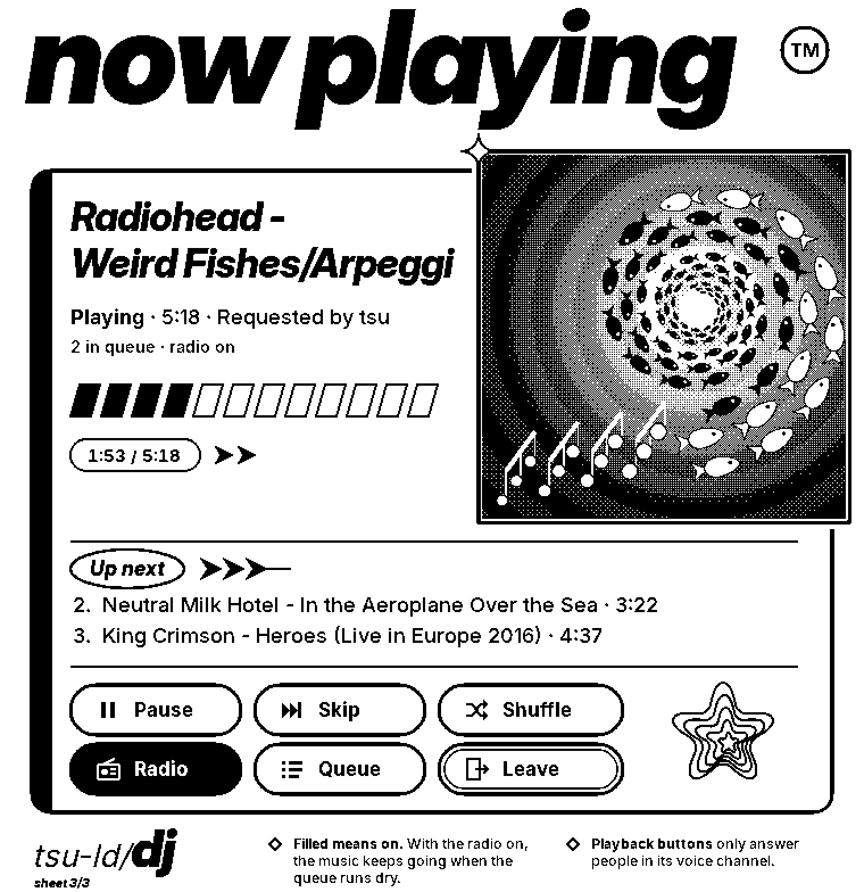
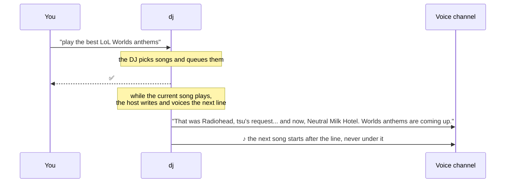

<p align="center">
  
</p>

<p align="center">
  <b>A radio host for your Discord voice channel.</b><br>
  Say what you want to hear, in your own words. It plays it, talks between songs like someone who loves being on air, and keeps the night going when nobody is asking.
</p>

---

Most music bots are jukeboxes with a command line. **dj** is built to feel like a person running the station:

| Instead of                           | dj                                                                                           |
| ------------------------------------ | -------------------------------------------------------------------------------------------- |
| Learning `/play`, `/skip`, `/queue`  | You type in the channel: `skip this one`, `play something chill`, a band, a link             |
| Dead air between songs               | A short spoken intro in the gap before the song. The music waits for it.                     |
| "Added to queue" after every request | A ✅ while it is on air; the live card shows the rest                                        |
| Autoplay looping the same few hits   | Radio that avoids songs it played recently, remasters included                               |
| Trivia from the model's imagination  | Facts from Deezer, Wikipedia and recent news; the host is told to state nothing else as fact |
| Everyone treated the same            | It remembers who asks for what: favorite songs, artists, request milestones                  |

<p align="center">
  
</p>

## What it does

### Talk to it like a person

Pick a channel (`@DJ #music`) and every message there is a request. You don't need to mention the bot. A fast router reads each one and sends it to the right place:

- a control: `pause`, `shuffle`, `remove 3`;
- a search: `lofi beats`, a YouTube or Spotify link;
- or the DJ: `play something to cook to`, `recommend me a band`.

The DJ picks songs itself when you ask for a mood, a genre or an era. Mentioning the bot always reaches the DJ.

### A host on the air

With a voice configured, the DJ speaks in the gap before a song starts. The song waits for the line, so the host never talks over the music.

- **It knows when to stay quiet.** One requested song in three gets no line, and the radio's own picks talk less. Every second line is a little longer.
- **Every line is about one thing.** That can be who asked for the song, what just played, or a listener's milestone. It can also be a fact the host can back up: the album, the release year, an anniversary this week, or a headline from the last two weeks.
- **It is the radio.** Songs nobody asked for are its own picks, introduced like any other song. When the last song was skipped, it doesn't announce it as if it played. It moves on.
- **Lines are written ahead of time,** usually while the previous song plays. They're spoken with audio tags like `[laughs]`, in the persona's language.

### A card that keeps up

<p align="center">
  
</p>

One card per server shows:

- what is playing and who asked for it;
- a progress bar that moves every 15 seconds;
- the next three songs;
- buttons for pause, skip, shuffle, radio, the queue and leave. **Leave** asks before it stops the music.

The queue view pages through everything waiting. When the chat scrolls past the card, it reposts itself at the bottom.

### Radio that keeps going

Turn the radio on and related songs keep playing after the queue runs dry. It remembers the last 30 titles per server, alternate uploads and remasters included, and prefers anything it hasn't just played.

### A personality per server

`@DJ from now on, talk like a cumbia DJ who never stops joking` changes how it talks; it needs the Manage Server permission. The persona and the listening channel survive restarts.

### Built to behave

- **A broken piece never stops the music.** No voice, no model, or a fact source that is down: the line is skipped and the song plays. Without a model it is still a quick, clean music bot.
- **Controls belong to the room.** Pause, skip, shuffle, radio and leave only work for members in its voice channel.
- **It refuses what it shouldn't play.** Live streams and links from anywhere but YouTube and Spotify are turned away.
- **Hard limits.** 50 songs per playlist and 200 in the queue. The audio cache is trimmed back to 512 MiB.
- **Titles and names stay data.** In the DJ's and the host's prompts they are fenced off as data, never read as instructions.

## Quick start

You need:

- **[Bun](https://bun.sh) 1.4.5+**;
- **FFmpeg** and **[yt-dlp](https://github.com/yt-dlp/yt-dlp)** on `PATH`;
- a bot from the [Discord developer portal](https://discord.com/developers/applications) with the **Message Content** intent on, invited with View Channels, Send Messages, Embed Links, Add Reactions, Read Message History, Connect and Speak.

```bash
bun install
export DISCORD_TOKEN=your_bot_token
bun run start
```

Then, as someone with **Manage Channels**, type `@DJ #music` in the channel it should listen in. Join a voice channel and post a song name or a link.

With only the token, you get a music bot: searches, links, the card and its buttons. **The full station needs three more pieces.** Plain-language controls need the router, conversation needs the DJ, and spoken lines need both the DJ and a voice:

| Set                                                        | And you get                                                                                                                                                                                                                    |
| ---------------------------------------------------------- | ------------------------------------------------------------------------------------------------------------------------------------------------------------------------------------------------------------------------------ |
| `LLM_BASE_URL`, `LLM_API_KEY`, `LLM_MODEL`                 | **The DJ**: conversation, song picks, in-character replies and the writing of every spoken line. Point `LLM_BASE_URL` at the full `/responses` URL of an OpenAI-compatible endpoint. The default model is `deepseek-v4-flash`. |
| `DECISION_BASE_URL`, `DECISION_API_KEY`, `DECISION_MODEL`  | **The router** that turns plain messages into controls, searches or DJ requests, using a System One endpoint such as [Jev](https://typesafe.ai). Without it, plain messages are searched and only mentions reach the DJ.       |
| `SPEECH_API_KEY`, `SPEECH_VOICE_ID`, `SPEECH_MODEL_ID`     | **The voice on air** ([ElevenLabs](https://elevenlabs.io), `eleven_v4` by default). A Spanish (Argentina) voice from their library suits the default show.                                                                     |
| `MUSIC_METADATA_CLIENT_ID`, `MUSIC_METADATA_CLIENT_SECRET` | Spotify's official API for Spotify links, before the web fallback.                                                                                                                                                             |
| `assets/welcome.mp3`                                       | A short intro the first time it joins voice in a server after it starts.                                                                                                                                                       |

## How a song goes on air



## For contributors

- [VISION.md](VISION.md): what dj is, the tenets that decide trade-offs, and what it will never be.
- [AGENTS.md](AGENTS.md): commands, the map of the code, the words we use and how we write it.
- `bun check` formats, lints and type-checks; `bun test` runs the tests. CI runs both.

MIT licensed.
