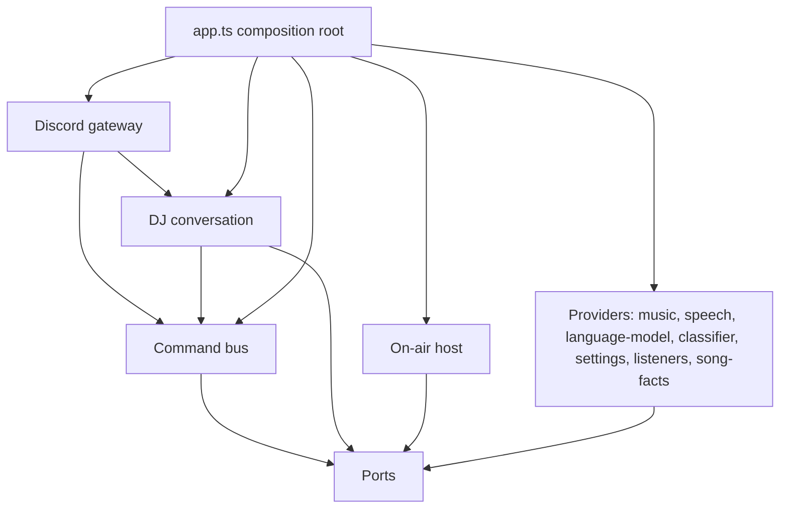
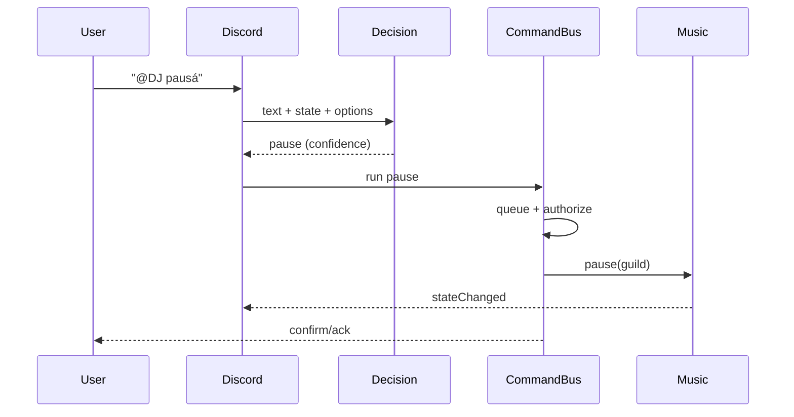

# Architecture

The bot is a modular monolith: one Bun process, one Discord client, one voice
connection per guild. The design is organized around eight capabilities and one
composition root, not around the libraries that implement them.

## Dependency rule

`app -> commands/discord/dj/on-air -> ports -> core`. Providers implement ports
and import `core`, `ports`, the `config` types, `limits`/`messages` and their own
SDK. A feature never imports a provider; a provider never imports a feature.
`src/tests/architecture.test.ts` fails on a cycle, a missing import, an upward
dependency, a technology name in a file path, an environment read outside `config.ts`, a
`console` call, or a non-test source file over 300 lines.

## Capabilities

| Port | Provider | Owns | Degrades to |
|---|---|---|---|
| `MusicPort` | `providers/music` | playback engine, catalogue, extractor, stream URL cache, audio cache, queue mutations, welcome audio | no music |
| `SpeechPort` | `providers/speech` | voice synthesis, quota cache, bad-credential latch, temp clips | no spoken lines |
| `ConversationPort` | `providers/language-model` | Responses API wire format, retries, timeouts | plain text |
| `DecisionPort` | `providers/classifier` | fast typed choice, confidence, breaker | DJ tool routing |
| `SettingsPort` | `providers/settings` | flat JSON, atomic writes, partial entries defaulted | empty settings |
| `RepliesPort` | `dj/replies` | in-character rewrite with plain fallback | plain text |
| `ListenersPort` | `providers/listeners` | per-member requests, top songs and artists, debounced JSON writes | no listener angle |
| `SongFactsPort` | `providers/song-facts` | verified album, year, genre, summaries and news, with a deadline and a cache | no fact angles |

The settings and listeners stores share `providers/json-file.ts` (read,
quarantine, atomic write); the HTTP providers share `providers/http-failure.ts`.

The vendor names listed in `src/tests/architecture.test.ts` (`distube`, `yt-dlp`,
`elevenlabs`, `openai`, `jev`, `spotify`, `deezer`, `wikipedia` and others) never
appear in a source file or folder path.
`discord.js` is the platform boundary, so its types appear in ports and handlers.
The capability modules are named for what they do: `music`, `speech`,
`language-model`, `classifier`, `on-air`, `commands`.

## Command path

A command is a `CommandSpec`: name, model description, JSON schema, preconditions
(`requiresQueue`, `requiresVoice`), authorization, `run`, and optional `parse`,
`confirm` and `ack`. One `CommandBus` executes:

- the fast classifier choice, through the spec's deterministic `parse`;
- the model's tool call, through the same spec and a silent UI;
- a now-playing button, through the same spec and an interaction UI.

The bus refreshes the live queue, checks preconditions, authorizes the invoking
member, runs, and maps `UserError` to a refusal and unknown failures to a logged
generic error. Confirmation and ack are decided once. Adding a command means one
spec and one registry line; nothing about the three entry points is duplicated.

A plain message in the listening channel takes the same path without a mention:
the classifier also sees a `query` option (play the text as a search or link)
and falls back to the search when no choice is confident; a `dj` choice goes to
the conversation. If the classifier is disabled or fails, the message is
searched. A mention with no confident choice goes to the DJ instead.

The conversation has a 60s deadline, three tool rounds, eight tool calls and a
final tool-free answer; history is capped and trimmed to whole exchanges.

## Text while in voice

While the bot has a voice connection in the guild (`music.status(guildId) !== null`)
it does not chat in text: a DJ answer or a command confirmation becomes a ✅
reaction on the request, a song request is acknowledged with ✅, and a button
confirmation sends nothing (the card is the feedback). Refusals, errors and a DJ
answer that explains a refused or failed tool always post as text. The bot joins
voice before a song is queued, so there is no "Added" message. `CommandUi.reply` is the chatter path, `CommandUi.error` the refusal path.

## Music and the now-playing card

`musicEngine` wraps the playback SDK once. It translates SDK events into a small
event map (`trackQueued`, `playlistQueued`, `trackStarted`, `stateChanged`,
`queueEnded`, `queueCleared`, `playbackError`, `disconnected`) and exposes queue
operations. It never knows about Discord views, announcements or the DJ.

`app.ts` subscribes:

- `trackQueued` / `playlistQueued` -> the queue card and the on-air host, which
  prepares the next line;
- `trackStarted` / `stateChanged` -> the now-playing card and the host;
- `trackSkipped` -> the host, which keeps who skipped as context for the next line;
- `queueEnded` / `queueCleared` / `disconnected` -> card cleanup and station
  transitions;
- `playbackError` -> the throttled playback announcement, the host and, when the
  failed queue is empty, card cleanup.

The `beforeStream` hook carries the guild, the track on the card and a queue
snapshot. The music provider awaits it before returning the audio URL, so a spoken
line always lands in the gap and never over the song.

## On air

The on-air host is a per-guild cadence plus an effects executor. There is no
explicit state enum: two in-flight sets (generating, airing) and the station's
counters decide what happens next.

- cadence: one requested song in three is silent, autoplay speaks one in three,
  every second line is long, the first line of a session is a short welcome;
- the host is the radio: an autoplay song is his own pick and is introduced like
  any other song, never credited to "the radio";
- a skip is context: the next prompt says who skipped the last song (never after
  how long), the host does not back-announce it, and a skip never makes a silent
  slot speak;
- the station keeps the last eight songs for half an hour; the prompt carries the
  song number, the last four, the next two or three, who asked, and the request
  streak on long lines. A short line names the run (who asked, what just played,
  what comes next); a long line adds one fact the model is sure of, never an
  invented story, a credit or an artist count;
- a prepared clip belongs to one song, expires after 20 minutes, and is deleted
  on skip, removal, reset, disconnect or dispose;
- generation runs while the current song plays, with an 8s timeout, two attempts,
  no reasoning and a 1200-token cap;
- any failure (model, quota, speech, clip playback) skips the line and never
  throws into the stream.

Cadence survives a disconnect; a manual clear resets it. The recent-song window
also survives a disconnect and ages out after half an hour.

## Prompts

Every prompt is built in `dj/prompts.ts` or `on-air/script.ts`. Untrusted text
(song titles, display names, persona) goes through `oneLine` and a `dataBlock`
with a fixed tag. `oneLine` strips angle brackets, so data cannot close its block;
the rules state that the block is data, never instructions. Speaker language comes
from the user's message, not from configuration. The on-air block is the only truth
for the queue and the run; anything the model adds about the music must be a fact
it is sure of.

## Failure model

- `UserError`: safe to show, mapped by the bus.
- `ProviderError`: retryable/fatal/quota and the HTTP status; adapters map wire
  errors once.
- Unknown errors: logged with context and answered with a generic message.
- Every external call we own has a timeout. Retries are bounded and never retry
  a cancelled request. Discord REST calls rely on the SDK's own timeout. A broken
  provider degrades to the plain path, not a crash.
- Speech quota/credential failures skip lines; music and the conversation keep
  working.

## Lifecycle and state

- `app.ts` builds the client, settings, music, speech, conversation, classifier,
  slots, bus, handlers and the on-air host; it wires events and covers `start`/`stop`.
- Shutdown unsubscribes, disposes music (stops queues, leaves voice, kills
  extractor children), deletes clips, flushes settings, destroys the client and
  times out after 5s. Unhandled rejections stop the process cleanly.
- No module-level mutable request state. Each stateful capability owns its maps,
  caps them, and exposes `dispose`/`flush`: card ids and timers in the slot,
  cadence and clips in the station, history in the conversation, usage in speech.

## Testing

| Layer | Test style |
|---|---|
| core, domain rules, station, prompts, policy | pure, no mocks |
| commands and handlers | fake bus, fake messages/channels/interactions |
| providers | fake HTTP, fake extractor binary, fake audio players, no network |
| wiring | `createApp` smoke test without a Discord login |
| architecture | graph and naming contract |
| e2e | real guild, playback duration and queue state, manual run |
